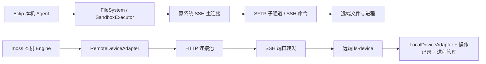

# Eclip 与 moss-agent 的 SSH 实现对比

## 比较范围与证据

本次比较的是“远程设备/项目如何支撑 Agent 任务”，不是两套产品所有模型、记忆和界面功能的排名。

- moss-agent：本地干净 `dev`，HEAD `41856a8590e31d2134fc9cf075ec7319c4d0b7ee`。用户提供的另一会话说明作为线索，本次另行读取相关实现；没有修改 moss-agent、运行其测试或连接真实服务器。
- Eclip：主目录当前未提交源码，CLI HEAD `20070d3f7171a95926bdd5c8153f5f382767fea2`、framework HEAD `91797fed1462ad9668956ddcf038998bc8353a84`，不能只用这两个 HEAD 代表完整源码。本次启动修复候选与原运行版本分别讨论。
- 原运行版本的“你好”：原 journal 确认保存输入到首个 Agent 状态事件为 32.499 秒。Eclip 修复候选已通过最终 14 项启动回归、81 项池回归、36 项 SSH 生命周期回归及 141 项 GUI Rust 测试，集合有重叠；这些不等于真实 GUI 操作或远程网络性能验收。
- 两者没有在相同网络、服务器、目录和模型上做配对性能测试。下文“更有利”指实现机制与数据流判断，不是已经量出的速度排名。

## 结论

moss-agent 更接近一套完整的远程执行设备：连接之外，还提供远端进程管理、操作受理记录、结果查询、设备能力及恢复接口。Eclip 当前更接近远程工作区客户端：利用目标已有的 SSH/SFTP 执行和读写，部署轻、接入直接，但远端任务控制与恢复的完整性较弱。

Eclip 这次 32.5 秒等待主要由重复准备、逐操作开关 SFTP 及串行探测造成。它不要求先部署远端服务才能修复。更大的工程搜索、反复工具调用、长进程管理和断线恢复，则暴露出两种架构的实质差距。

## 架构与责任边界

两者的模型调用和 Agent 编排仍主要在本机。moss 的常驻设备服务承接的是文件、命令、进程等设备操作，并不意味着整个 Agent 会在用户关闭本机 Engine 后继续自主推理。

Eclip 的框架保留通用文件/执行器接缝，产品负责 Workspace 与 SSH owner；这是合理的分层。moss 的产品负责认证、安装和转发，Engine 负责设备挂载，远端服务负责真实执行与结果，也有清楚的职责。moss 多出来的安装身份、服务实例、连接版本和操作记录各有用途，代价是需要维护更多组件及其兼容关系。

## 功能完整性

| 能力 | Eclip 当前 SSH 路径 | moss-agent 当前设备路径 | 判断 |
| --- | --- | --- | --- |
| SSH 登录与加密 | 系统 OpenSSH，原 PTY 认证及 ControlMaster | 系统 OpenSSH，ASKPASS；Unix 主连接复用，Windows 独立转发 | 都复用成熟 SSH；认证与平台策略不同 |
| 远端部署 | 不部署自有常驻服务；依赖目标 SSH/SFTP，部分操作另需 Git/Python 等 | 安装指定平台的 ls-device，验证摘要、bootstrap、建立转发并挂载 | Eclip 接入更轻；moss 初次接入工序更多 |
| 平台边界 | 当前项目 SSH 在非 Unix 本机上明确返回未取得资格，不能借桌面壳跨平台就宣称 Windows SSH 完整可用 | 本机连接代码区分 Unix/Windows；远端安装包限定 Linux/macOS 的 x64/arm64 | moss 的平台接入设计更广；两者实际平台资格均须独立验证 |
| 项目指令与扩展来源 | 按项目根到实际 cwd 加载 AGENTS.override/AGENTS；项目 Skill/Subagent 与本机用户来源分开 | 通过选定设备读取 AGENTS/CLAUDE、多个 rules 目录、Skill、Subagent 和 hook，再向 Engine 注入文本/定义 | 两者都有远端资源路径，查找范围和优先级并不相同 |
| 基本文件读写 | 标准 SFTP，含元信息、目录、流式读取和原子替换等 | 设备文件接口，二进制内容带长度/摘要校验，服务端执行 | 基本能力两者都有，不宜只数工具名 |
| 大目录搜索 | 当前 grep 等工具仍可在本机遍历并读取远端文件 | search/glob 等请求在远端 LocalDeviceAdapter 执行，返回结果 | moss 的计算位置更有利于大工程 |
| Shell 与 Git | 通过共享 SSH 主连接启动具体命令；Git 使用原执行接缝 | 设备服务调用远端本地实现，包含 Git 及工作区操作 | 普通命令两者可用；moss 设备合同更集中 |
| 进程状态、日志与终止 | 本机持有 SSH 子进程及物理结算；当前普通 SSH executor 的取消/超时仅观察 | 有 start/status/log/wait/terminate/release 等设备接口，服务端硬超时 | 这是 moss 当前更明显的功能优势 |
| 远端 MCP | Eclip 已有 MCP，但本项目 SSH 适配没有同等设备级远端 MCP 生命周期接口；具体位置取决于配置 | 设备协议提供 MCP prepare/start/acquire/health/stop/release 等接口 | 不能把本机已有 MCP 自动算作远端 MCP 完整支持 |
| 远端隔离 | plain SSH 明确不能证明远端 OS/进程/挂载隔离；相关要求会被拒绝 | 在远端验证并调用当地隔离能力，结果仍取决于主机支持 | moss 有更合适的执行位置，仍须看能力声明 |
| 受管工作树 | 依赖原目录身份等保全条件；SFTP 后端不满足时明确拒绝，普通 GUI Git 操作另论 | 远端本地实现可使用当地目录身份及工作区接口 | 需要按具体入口验收，不能只凭 Git 可执行就算完整 |
| 实时目录通知 | 这条 SFTP 文件接缝没有远端 watch 接口 | RemoteDeviceAdapter.watch_directory 明确返回不支持 | 两者都不能据此宣称远端实时目录同步已完整实现 |
| 多项目/设备组织 | 以 Workspace Host 固定执行位置，原任务/子 Agent 负责跨工作区路由 | 以设备对象挂载到 Engine，再供项目/Chat 引用 | moss 更适合独立管理设备；Eclip 更贴合现有工作区产品 |

依据：[moss 远端接口](</Users/ls/MyWork/code/python/moss-agent/src/ls_agent/device/remote_adapter.py:640>)、[远端本地实现](</Users/ls/MyWork/code/python/moss-agent/src/ls_agent/device_service/native.py:132>)、[Eclip SSH 能力校验](</Users/ls/MyWork/code/ylp_agent_learn/lp-agent/echo-agent-cli/echo-agent-app-core/src/terminal/project_ssh/sandbox.rs:365>)。

## 任务运行性能与效率

### 首次接入和每条消息启动必须分开量

moss 首次连接需要平台探测、安装包核验/上传、服务启动、端口转发及协议握手。已安装、已连接后的日常操作不应重复支付这些成本。Eclip 接入工序更少，但原实现把昂贵文件访问放在每条消息的关键路径上；即使 SSH 已登录，也会慢。

因此至少需要分四项比较：第一次安装设备、已安装设备重连、连接就绪后新对话的首次请求、持续工具调用。当前“你好”的 32.5 秒属于第三项，不能拿它与 moss 安装完成后的单次 HTTP 请求直接相比。

### 稳定连接下的请求开销

moss 的 RemoteDeviceTransport 长期保留普通请求、事件和长等待三组 HTTP 客户端，连接池上限分别为 8/4/8。进程等待使用独立池，减少长等待挤占普通文件请求连接的机会。日常文件操作不必再启动一个系统 SSH/SFTP 子进程。

Eclip 本次修复让整个上下文读取共用一个 SFTP 子通道；已知标志文件的 STAT 最多 32 项在途，按原优先级解释。新消息仍刷新规则，首次创建不再重复做一份完整结构/规则准备。它修复了启动链，但普通文件工具和 SSH 命令仍有各自通道/子进程开销，不能据此宣称所有远程任务开销都消失。

要分清统计口径：对四级无标志目录，一次根发现仍可能有 40 条 STAT；“两次批量接口调用”不是“两条网络请求”。收益来自去重、共享通道和减少串行等待。

依据：[moss HTTP 池](</Users/ls/MyWork/code/python/moss-agent/src/ls_agent/device/remote_transport.py:56>)、[Eclip 只读会话与 STAT 实现](</Users/ls/MyWork/code/ylp_agent_learn/lp-agent/echo-agent-cli/echo-agent-app-core/src/terminal/project_ssh/sftp.rs:80>)。

### 与本次启动缺陷最直接相关的实现差别

moss 不仅复用传输，还在资源装配时并发处理独立工作：项目资源与 Git 查询并行；规则、Skill、Subagent 和 hook 分组并行；几个固定规则候选也并发读取。全部工作结算后，再按原来源顺序解释错误和拼装结果。Eclip 本次采用的“并发传输、保持优先级、错误不能静默丢失”与这一做法一致。

moss 的规则扫描入口从已经选定的设备 workdir 枚举候选，不执行 Eclip 当前那种逐祖先 VCS/包标志搜索。项目选择和规则继承合同不同，不能把更少探测直接算作同等语义下的速度胜利。

还要对齐提供给模型的信息量：Eclip 的结构上下文预取目录树、Git status 和 diff stat；已核对的 moss 资源注入入口明确装配规则/扩展并传递工作区分支，完整模型请求还可能由其它来源补充。比较首请求时应同时记录最终上下文内容和 token 数，不能把两边默认准备工作视为天然相同。

它仍会产生多次设备调用，部分目录里的文件也逐项读取。另有目录打包/捕获接口供插件资源处理，在特定批量场景减少跨网络往返；这不表示所有规则、任务和文件都已自动缓存或获得事务快照。因此“常驻服务已经安装”也不能代替对每条消息实际准备次数的测量。

依据：[资源与 Git 并发](</Users/ls/MyWork/code/python/moss-agent/app/backend/src/routes/_sessionHelpers.ts:395>)、[资源分组并发](</Users/ls/MyWork/code/python/moss-agent/app/backend/src/services/project-resources.ts:10>)、[规则候选与来源顺序](</Users/ls/MyWork/code/python/moss-agent/app/backend/src/services/project-rules.ts:126>)、[设备文件及目录捕获](</Users/ls/MyWork/code/python/moss-agent/app/backend/src/services/project-workspace-files.ts:50>)。

### 大工程与反复搜索

这比“Rust 或 Python 哪个快”更重要。Eclip 当前 grep 在本机递归目录，再通过 FileSystem 读取候选文件；用于 SSH 后端时，文件内容会跨网络送到本机再匹配。moss 的 search 请求在设备服务内调用当地的 guarded_grep，只把结果送回来。

例如，在不提前达到结果上限的假设下，搜索 1000 个合计 10MB 的候选文件、最终只有 1KB 匹配结果，前者可能需要传输候选正文，后者可以主要传输匹配结果与协议元信息。这是数据流示例，不是实测数字。大仓库和高延迟网络下，把扫描留在目标机器更有利。

Eclip 也能通过 shell 在远端运行已有搜索程序；问题在于结构化 grep 工具当前的默认路径没有获得同等优势。仅优化启动时的 SFTP 通道，尚未解决这项结构成本。

依据：[Eclip 客户端搜索](</Users/ls/MyWork/code/ylp_agent_learn/lp-agent/echo-agent/echo-tools/src/files/grep.rs:351>)、[moss 远端搜索入口](</Users/ls/MyWork/code/python/moss-agent/src/ls_agent/device/remote_adapter.py:763>)、[服务端当地搜索](</Users/ls/MyWork/code/python/moss-agent/src/ls_agent/device/local_adapter.py:988>)。

### 并发与小操作

moss 有长期复用的连接、独立等待池和服务端操作容量管理，适合长进程与许多设备调用混合。它也有 JSON/二进制协议、摘要校验及操作记录的成本，不能预设每一次小文件操作都比 SFTP 快。

Eclip 的新准备阶段不再长时间持有整个实例表锁，已有会话可以继续取得 Agent；这个收益与是否部署服务无关，是应用调度实现必须修好的问题。实际高并发还需要检查 SSH 子通道预算、blocking 线程与网络往返；语言本身不能替代这些测量。

资源效率也有不同代价：moss 持续维护服务、连接池和结果存储；Eclip 没有自有远端常驻服务，但短通道和子进程的反复创建会消耗 CPU 与调度资源。低频、临时接入更容易体现 Eclip 的轻量优势；持续高频工具操作更容易摊薄 moss 的服务成本。需要同时测本机/远端 CPU、峰值内存、传输字节及进程启动次数，不能只数常驻进程。

## 容错、取消和恢复

| 故障/操作 | Eclip 当前保证 | moss-agent 当前保证 |
| --- | --- | --- |
| 响应丢失，但远端可能已修改 | 保留原物理 owner、可能副作用及 unknown，不把关闭本地 SSH 当回滚 | 保留稳定操作 ID/输入摘要；重新查询远端受理/结果记录 |
| SSH 断线，远端执行者仍健康 | 没有同等常驻设备接口查询原操作结果；通常需要核对目标状态 | 重建转发及设备挂载后，可查询原记录和进程/日志 |
| 连接健康与重连 | 依靠原连接检查、目标/位置版本和重连入口保护执行位置；不能把新认证当原操作已恢复 | 每 5 秒探测，最多 5 次退避重连；SSH 健康而 Engine 重启时重新挂载 |
| 远端服务进程重启 | 没有自有服务需要升级或重启，但原 SSH 结果仍可能不可确认 | 已持久化完成结果可保留；原 accepted/running 会改为 unknown，而非自动重放 |
| 本机 Engine/App 退出 | 不能由本机继续发新的 Agent 决策；远端命令状态须按原证据判断 | 本机 Agent 决策也会停止；已交付远端的进程及其时限可由服务继续管理 |
| 用户取消/到时 | 当前 ProjectSshSandbox 将取消/超时记为观察事实，继续等原命令自然结算 | 设备有远端进程终止接口及服务端硬超时；具体进程终止仍要等真实状态 |
| 旧连接的迟到请求 | Workspace/目标版本与原连接身份保护既有 host | 安装/实例/连接版本等绑定拒绝过时请求 |
| 移除仍在使用的目标 | 等待原 workspace、I/O 与执行资源结算，不能借关闭观察者清理 | 退役/撤权前核查任务、引用和未确认操作，避免假移除 |

最需要正视的是取消能力。Eclip 的当前普通 SSH executor 在取消或超时后设置标志，等待原物理命令结果；没有在这里发送远端进程终止。它诚实地避免“假停止”，但用户会看到取消后仍等待。moss 远端服务持有进程，因而有条件真正执行 terminate 与硬超时。这是功能完整性差距，不是把 UI 状态提前改成已取消就能补齐的。

操作记录也不等于任何故障下都能“恰好执行一次并自动成功”。moss 在服务重启时把未完成记录改为 unknown，正说明文件副作用与结果入库之间仍有不能凭空补证的窗口。其优势是身份、受理和结果更可查询，而不是消灭了所有未知状态。

依据：[Eclip 取消/超时观察循环](</Users/ls/MyWork/code/ylp_agent_learn/lp-agent/echo-agent-cli/echo-agent-app-core/src/terminal/project_ssh/sandbox.rs:265>)、[moss 操作受理与去重](</Users/ls/MyWork/code/python/moss-agent/src/ls_agent/device_service/operations.py:397>)、[服务重启的 unknown 处理](</Users/ls/MyWork/code/python/moss-agent/src/ls_agent/device_service/operations.py:115>)、[远端硬超时](</Users/ls/MyWork/code/python/moss-agent/src/ls_agent/device_service/native.py:236>)。

## 实现难度与维护成本

| 项目 | Eclip 直接 SSH/SFTP | moss 常驻设备服务 |
| --- | --- | --- |
| 接入依赖 | 使用目标已有服务，自有安装负担小 | 需要可安装/启动服务、允许转发及相应平台包 |
| 实现主体 | 传输适配、原工具复用、位置与资源生命周期 | 额外包含安装器、设备协议、服务生命周期、操作记录、版本与实例绑定 |
| 性能设计难点 | 防止本地文件算法变成大量串行远程调用 | 控制请求池、服务端容量、协议开销与日志存储成本 |
| 恢复设计难点 | 缺少持久远端执行者，结果确认选择较少 | 需维护受理与执行窗口、服务重启、查询/去重、旧连接失效 |
| 发布升级 | 主要发布本机 App，目标的 OpenSSH/SFTP 独立维护 | 要兼顾本机后端、SDK/Engine、协议和远端发布包的兼容 |
| 故障面 | SSH/SFTP、目标命令及本机 owner | 另有安装包、远端进程、转发端口、设备握手及状态存储故障 |
| 使用体验 | 适合临时主机、只想连已有目录的用户 | 适合经常使用同一设备、需要长进程及断线后继续核对的用户 |

Eclip 的实现也不是几行 SSH 封装：当前跨 blocking/async 的文件访问、资源结算和位置绑定都需要严谨处理。moss 更完整的能力对应更大的工程投入，不能用代码量多或状态多直接判断设计优劣。

一个具体体验差别：moss 当前 `/test` 与 `/connect` 走同一个正式连接入口，因此“测试连接”也会安装或启动远端服务。Eclip 的测试连接只检查原 SSH master，创建/进入项目时再校验目录。前者验证范围更完整，后者副作用更小；界面必须让用户理解实际动作。

依据：[moss test/connect 同路由](</Users/ls/MyWork/code/python/moss-agent/app/backend/src/routes/devices.ts:72>)、[Eclip 原连接检查](</Users/ls/MyWork/code/ylp_agent_learn/lp-agent/echo-agent-cli/echo-agent-app-core/src/terminal/project_ssh.rs:496>)。

## 对 Eclip 的取舍建议

本次启动修复继续完成并交付现有路线：一次准备、阶段内复用、已知路径有界探测、短池锁，以及完整初始化与取消/退休回归。这些是当前实现应满足的基本要求。

后续最值得借鉴 moss 的两项能力，是把大规模搜索/目录扫描留在目标机器，以及让远端进程有可查询的状态、日志和真实终止。前者可以先评估利用既有 SSH 执行接缝；后者若要求跨断线或客户端重启可靠管理，常驻设备服务更有优势。

是否采用完整 ls-device 式架构，取决于 Eclip 是否明确要把远端主机作为长期任务执行设备。若主要目标仍是轻量访问远程项目，直接 SSH/SFTP 经正确优化有价值；若目标包括长任务独立托管、稳定操作查询、远端 MCP 与设备级恢复，moss 当前路线更接近所需能力，需要把部署、协议与升级作为同一个产品范围来设计。

moss 的数据库、产品/用户权限结构不能直接搬进 Eclip。Eclip 是本地个人助理，CLI 侧禁用 SQLite 的既有产品边界仍有效；可借鉴稳定身份、结果查询和目标侧执行的机制，不复制不适用的产品存储或权限体系。

## 配对验收建议

使用同一远端主机、目录数据、网络条件和模型配置，分别记录：首次安装/接入；已安装重连；新对话与后续消息的输入保存到首个请求；1000 文件搜索的请求数/传输字节/耗时；并发短工具与长进程；命令发出后断线、响应丢失、服务/客户端重启；取消到远端实际停止的耗时。记录成功、失败、unknown、重复副作用及残留进程，不能只报平均延迟。

验证时分清两个问题：设备操作是否恢复，与整个 Agent TaskRun 是否从正确位置恢复。设备服务提供进程/结果接口，并不自动证明 Agent 会话、任务图和模型上下文也已完整续接。
