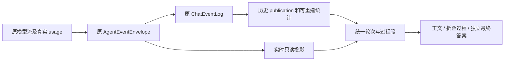

# Eclip 界面优化设计

## 审查结论与证据

本设计依据 2026-11-07 用户的三组截图和“先根因 review，再设计与计划”的要求编写。当前实现审查结论为 **block**：4 项 Important、1 项 Minor；这表示实现不满足目标，不表示本设计已经实施。独立只读 reviewer 未运行测试或 App。

审查快照：应用 `5f5fd4912855cfda2326c54f294f11cb879257fa`、框架 `f2e44dc9be8972e286f9a84520ddb263f0012424`，加主目录现有未提交增量；ZCode 参考快照 `3c5b227649371507ddc4eb46ac5133afe6db1cab`。根目录及子仓库当前均为非 main 分支。实施前必须核对 HEAD 和实际文件增量，不能只核对提交号。

| 编号 | 严重程度 | 根因、证据与影响 | 处理结论 |
|---|---|---|---|
| UI-01 | Important | 原 `NativeMessageTimeline` 按每个 reasoning/tool 建独立行，只有块级折叠。实时 `chatStore.ts:394` 将多次模型请求放入同一消息；冷历史 `conversationStore.ts:648` 按 canonical assistant 分成多条消息，`ChatPanel.tsx:594` 逐条渲染。单消息折叠不能覆盖同轮历史。 | 建立应用只读轮次投影，再做正文段与过程段。 |
| UI-02 | Important | `chatStore.ts:46,658` 仅累计 input/cache，加载历史清零；`types/api.ts:259` 的 usage 没有可比较的生成计时。journal 默认回放上限 4096（`chat_event_log/event.rs:39`），publication 检查点不聚合 usage（`projection.rs:37`）。 | 补真实计时和原日志可重建聚合，不能只加底栏或扫描尾窗冒充累计。 |
| UI-03 | Important | `AgentComposerFrame.tsx:21`、`ChatInput.tsx:1107,1129` 的最小高度、textarea padding 和框外 toolbar 叠加；`ChatPanel.tsx:520` 与输入框各有停止入口。 | 一并调整输入区盒模型及停止入口，而非仅移动按钮。 |
| UI-04 | Important | 上轮提前修改了 4 个前端文件和 1 份说明，未验证；现有测试仍要求多个独立 reasoning 折叠入口，与候选聚合行为冲突。 | 候选须重新对照设计和完整验收，不作为已完成切片。 |
| UI-05 | Minor | 候选 `detailsOnly` 展开后，只有工具引用、没有 summary/transcript 时，`InlineToolCall.tsx:210` 返回空。 | 缺记录仍展示原引用和未恢复说明，不把无证据呈现成无过程。 |

上轮候选范围为 `NativeMessageTimeline.tsx`、`MessageBubble.tsx`、`ExecutionProcessGroup.tsx`、`ToolExecutionGroup.tsx` 及 `docs/zh/guides/gui-task-runtime-panel.md`。起始字节回执在应用 `.echo-semantic/local/chat-process-folding-20261107-r01/start.json`。本轮不继续、回退或采用该候选，也不改动其它会话的 dirty 文件。

## 目标与范围

形成同一套可用于实时、历史、分页和 Fork 的聊天阅读方式：运行中正文清楚可读，中间过程一行摘要；最终结果发布后可折叠全部中间内容；输入区紧凑，统计真实且可解释。

范围包括应用的消息投影、原 journal 的可重建统计投影、必要的通用计时观测、前端交互与所属中文文档。模型任务、工具执行、权限规则、Goal 与发布资格继续由原 owner 决定。本设计不是 SQLite、第二套消息 store、运行状态机或 SDK 升级方案。

## 分层与复用

| 层次 | 责任 |
|---|---|
| 通用框架 | 在原模型请求消费处产生可选的请求关联与计时观测，保持 provider 原始身份、usage 和最终发布语义。 |
| Eclip 应用 | 从同一原 envelope 投影轮次身份；维护原 ChatEventLog 下可重建的统计；定义统计范围、折叠和输入区产品行为。 |
| 适配边界 | `NativeHistoryPresentation → SavedMessage → ChatMessage`、原 `chat_driver → ChatEventLog → frontend`，只转换与投影，不拥有结束或保存成功权威。 |

复用 `ToolExecutionGroup`、`InlineToolCall`、`ParallelExecutionBlock`、`MarkdownContent`、现有菜单、HITL、发送回执、保存事实和 Fork 验证。轮次投影统一替换平行的实时/历史分组，不另建可变消息副本或长期双路径。`completedReplyForks` 保留其现有 Fork 索引职责，不能升格为轮次身份权威。

## 目标行为

### 可信轮次与过程段

展示结构为“轮次 → 正文段／过程段 → 已确认最终答案”。实时和历史均使用原 `workspace/conversation/root_turn/turn/execution` 坐标；相邻 reasoning 与工具合成一个过程段，公开 Commentary、PartialAnswer、Unknown 正文仍按原顺序分隔过程段。明确归属的 Subagent 进入对应过程；不可把相同标题或相同文字当作同一运行。

运行时，过程段默认只占一个正常文本行，概括思考、工具数量及真实 running/失败/取消/未知状态。点击或键盘激活后显示全部原序记录，可再次折叠；展开后工具的原始参数与日志沿现有详情入口读取。缺 summary/transcript 时保留原工具身份和“详情未恢复”，不出现空展开区。

轮次 key 绑定目标容器及可信 root_turn/turn/execution 坐标，不因分页变化。边界完整的过程段以原前置正文边界或已知段起点为 key；只加载到段中部时标记 partial 身份。补前缀导致临时段合并或边界被确认时，建立原段到完整段的纯 UI 别名并迁移展开状态、焦点和原事件滚动锚点，不能简单按新的最早事件重新初始化。多个临时段合并时采用用户最近一次显式展开/收起选择；没有选择则沿默认值。该临时映射不是持久化权威。

流式追加不会因计数、状态或正文增长而重挂载；分页纠正可调整 DOM，但必须保持用户展开选择、焦点和原事件锚点的可见位置，不能承诺与边界纠正冲突的绝对“不重挂载”。

### 最终结果与异常

只有原发布链确认的非空最终正文及匹配来源，才触发本轮整体默认收起。所有中间正文、思考、工具及归属明确的 Subagent 可由一个“执行过程”入口整体展开/折叠，最终答案及其操作保持独立可见。局部过程段仍可单独展开。仅候选 phase、块 `complete`、流结束、保存成功或 TaskRun 文案不授予最终资格。

失败、取消和未确认结果不标为成功，也不自动隐藏唯一诊断。失败原因、保存 blocked/unknown、等待审批/用户输入等需用户处理的事实位于折叠层之外；最终发布后迟到的保存告警仍可见。原相同 operation/generation 的后继确认才解除对应保存告警。产物、附件、图表和操作资格保持原来源与 owner。

### 历史、分页与 Fork

从已经核验的 publication envelope 投影可选轮次坐标；旧记录无坐标或坐标冲突时保留原行并标记关联未恢复，不根据措辞、相邻时间、最后一条 assistant 或 provider request ID 猜测运行 owner。分页补齐早期消息后，同一可信身份归入同一轮；关联只改变只读呈现，不合并或改写 canonical 历史。

Fork 保留源 provenance 与目标容器的区别，不把源执行伪装成目标 owner。目标会话累计只计它实际发起的主链请求；继承前缀的源 usage 仅在来源明细展示，不计入新会话账目。新请求实际发送继承上下文时，其新上报输入费用正常计入目标会话。编辑、重新生成或回退不冲销同会话已经发生的请求消耗；活动展示分支与实际累计消耗不混为一个指标。Steer、新输入和多 execution 不互相串组，冷加载与相同 journal 的实时视图得到同样的正文/过程顺序。

### 输入区与响应布局

附件、workspace、权限、思考深度、模型和发送/停止放在输入框内部底行；textarea 为这些控件预留准确空间，去除框外高 toolbar 和重复停止入口。外侧只留一行统计，常见桌面宽度不额外换行；窄屏先缩短模型/provider 和辅助标签，保留可访问名称、权限与停止入口，必要时统计有序换行，不横向溢出。

保留现有草稿、附件、队列、发送幂等键、输入接纳回执及下拉菜单 owner。菜单不被输入框裁切；键盘、触摸和鼠标均可操作。

### 统计定义与恢复

主行显示目标会话实际发起主链的轮数、主模型步骤数、可用输出速度、累计 tokens、累计缓存命中率、当前上下文占用。轮数按原准入的主轮次计数；步骤是主模型的一次逻辑调用，重试尝试的收费单独累计，明细列出尝试数，不能把重试误当新用户轮次。Subagent 和标题/压缩等辅助调用在明细单列；主行明确为主链累计，不把父子消耗重复相加，回退或隐藏消息不冲销既有消耗。

- 缓存率：已报告主链请求的 `sum(cached input) / sum(total input)`。cache write 不计 hit；inclusive input 不重复加 cache；缺 usage 显示未知或覆盖不完整，不能默认为 0%。失败请求只要原 provider 上报消耗，仍计入相应尝试。
- 累计用量：同一范围的输入与输出之和，与当前一次请求的上下文窗口分开。上下文只消费最新合格的主链 prompt usage，并加尚未发送草稿估算；草稿不进入计费累计。
- 速度：主行显示最近一次完成且口径可比较的主链尝试，公式为 `completionTokens × 1000 / (lastOutputMs − firstOutputMs)`，明确标为客户端观测速度。completion 包含 provider 计入的推理、正文与工具输出时，时间也必须覆盖同一范围；provider 明确提供的生成时间单独标注、不与客户端时间混用。当前请求尚未完成时显示“上次”已完成合格值；没有合格值时为 `--`。重试尝试各自取样，取最后一个已完成且合格的主链尝试，不拼接不同尝试时段。如明细提供会话观测速率，只按合格尝试的 `sum(completionTokens) × 1000 / sum(observedDurationMs)` 加权，不平均各次速率。请求总耗时含等待，不能冒充 decode；UI 收到 Guard 批量释放块的时间也不能代替源流时间。单包、计数/时间口径不匹配、opaque 输出覆盖不明、缺 usage 或非正时长显示 `--`，不按字符数估算。
- 累计重建：在原 ChatEventLog 的 journal identity、through-sequence、检查点与后缀重放框架内维护只读聚合；按原事件身份和尝试身份去重。已保留 journal 不覆盖历史且没有可信聚合时，显示统计不完整及覆盖范围，不拿 4096 事件尾窗冒充全量，不新建统计权威 store。
- 前台状态切换不清除 durable 聚合；clear 只按原操作对可见历史的语义处理，不能静默冲销已发生消耗。新 conversation 从其实际请求开始累计；同会话的编辑/回退保留既有消耗，模型切换明细分模型但会话累计继续。明细给出最近一次与累计缓存率、主链/子调用、覆盖范围及 Fork 继承来源；低命中率正常显示。

## 核心数据流与合同

在既有 `LlmUsage` 增加可选调用关联、可比较计时及覆盖说明，沿原 consumer 无损传递。缺字段不是 0；不得生成假的 provider request ID。新增通用字段须盘点框架内部、示例和合理公共消费者；SDK 使用独立精确 pin，本方案不自动改 SDK pin 或 wire 合同。

## 参考实现与取舍

ZCode 的 `packages/ui/src/v4/conversationTurnRenderUnits.ts:321,406` 先按协议轮次建立展示单元，再建立 work segments；`ConversationTurnGroup.tsx:637` 将历史过程作为可展开区域，最终正文和产物独立。选择其“轮次先于组件折叠”的组织方式，不复制业务状态推断。

本机 DeepSeek 官方 Harness `0.2.2-rc.1` 的 `dsh-client-ui-chat` 使用 whole-log tokenUsage 投影和可折叠过程，`dsh-token-meter` 对相同步骤 usage 替换、重试分开累计。ZCode 输入框生产环境隐藏低于 78% 的值只是展示策略，本项目不采用。原始安装包及提取副本见主根 `.echo-semantic/local/cache-diagnosis-20261107-r01/deepseek-harness-0.2.2-rc.1/manifest.json`。

未采用只减 margin、只包单个 MessageBubble 或只扫 journal 尾窗：分别不能解决节点过多、冷历史整轮关联和完整累计。选择原事实上的只读投影；不新增状态权威或要求用户维护 Agent 协作地址。

## 验收标准

| 场景 | 可观察结果 |
|---|---|
| 两段正文之间 20 个思考/工具条目 | 收起时一个过程行；展开后数量、身份、内容、顺序完整，无空占位高度。 |
| 流式追加、冷页从过程段中间开始再补前缀 | 轮次 key 稳定；partial 段合并迁移用户选择、焦点与原事件锚点，增量不强制收起。 |
| 最终发布与裸候选负控 | 合格 final 之后整轮默认收起、最终正文可见；裸候选/complete/EOF 不触发。 |
| 同一 journal 的实时、冷加载、补前缀 | 轮次与过程顺序相同，缺坐标不猜组，跨 execution 不误合并。 |
| 错误、取消、HITL、保存不确定 | 提示和操作始终可见，原状态和保存资格不改。 |
| 缺工具详情及 typed reasoning | 有未恢复占位；签名、redacted、opaque 原件不泄漏，公开 summary 仍完整。 |
| 重放、重试、超出 4096 尾窗、Fork 与回退 | 源继承 usage 不加入目标账目；新会话实际请求正常计入；同会话回退不冲销已发生费用；累计不重复、不假全量，缺覆盖有标识。 |
| 两次不同量/时长尝试、重试、新请求运行中与单包 | 主行取最近已完成合格尝试，新请求进行中标“上次”；会话明细按总tokens/总时长核算，不平均速率；不足时 `--`。 |
| 360px 与桌面布局 | 控件和最终结果可访问，无横向溢出；输入区不再单独占高 toolbar。 |

实现完成后必须区分组件/合同验证、真实 Tauri 点击、精确 main CI 和发布。当前没有上述新验证结论。

## 协作、文档与交付边界

本文件为顶层阶段性工程设计；长期 UI 说明更新应用 `docs/zh/guides/gui-task-runtime-panel.md`，发布/观测合同更新 ADR 0057；新的架构选择按所属仓库 ADR 记录。framework 通用计时说明归框架，不能把产品控件下沉框架。无新增模型工具，examples 不新增 UI 接口；若公共事件构造变化，现有示例必须编译。官网只同步真实可交付行为，不发布假命中率或未验收截图。

建议工程顺序为执行可靠性、缓存、UI 集成，但三份计划均独立验收，不把彼此未完成自动视为完成；共享 `think.rs` 等文件必须单一 writer、分批冻结。当前只授权评审、设计与计划，未授权实现、提交、推送、App 操作或发布；计划 `ready` 仅代表结构可执行。
