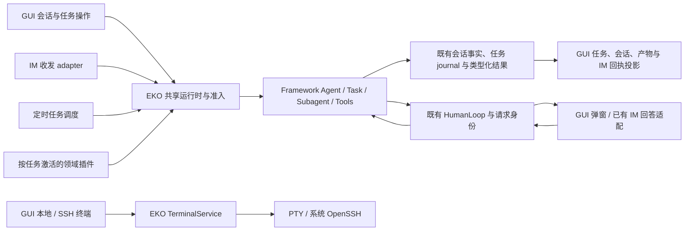

# EKO GUI 产品收敛、能力退役与协同交付设计

## 1. 文档定位与已确认目标

本文是跨 `eko-workspace`、`echo-agent`、`echo-agent-sdk`、`echo-agent-cli`、`echo-website` 的阶段设计入口，描述完整目标状态、分层、约束和验收。正式产品说明、API 合同和实现 ADR 继续由各子仓维护；本文不成为长期产品手册，不引入状态 schema，不包含函数级实施步骤或 Plan。

用户已确认：EKO 以 GUI 为主入口，保留 IM 渠道与定时任务；退役 EKO 的独立 TUI、交互式 CLI、JSONL 等产品入口，并退役框架、SDK、EKO 中的 A2A、LSP 能力；保留退役前完整版本。GUI 整体美化、项目工作环境与 SSH、HITL 弹窗、任务列表弹窗、内置工具治理、领域插件、Exa、工程收尾、性能基准、新增渠道及发布必须协调考虑。

2026-10-25 用户最新澄清覆盖此前“侧栏任务等于项目”的表述：**工作空间 = 项目 = 工程，即现有 Workspace；任务与会话归属于 Workspace。** 左侧分别提供“新建任务”“最近任务”“工作空间”，新建任务复用现有普通 Conversation 的新建草稿，不创建 Workspace 或代码目录。现有本地文件夹、新建本地文件夹、远程 SSH 设备与目录三种来源属于**创建工作空间**。SSH 独立终端仍只是底座，文件、Agent 执行与项目终端必须使用同一个真实工作环境；详见[项目工作环境细化设计及恢复依据](../../plans/2026-10-26-root-convergence/next-actions.md#项目工作环境细化设计恢复)。

首页按用户两张 WorkBuddy 参考图采用简洁留白、浅灰侧栏、宽而圆润的主输入区和轻边框，保留 EKO 品牌。主输入区左下为工作空间与权限，右下为模型；参考图只提供视觉组合，不复制品牌、吉祥物、无功能快捷卡或未承诺的产品模式。个人微信扫码和运行中追加输入（Steer）的增强也是已确认目标，分别沿原渠道与输入权威实现，不作为首页布局实施的等待条件。

2026-10-27 用户新裁决覆盖此前要求理解与自动传播方案：**普通 Steer 由主模型结合对话历史理解，并在执行中按需调整计划；不调用独立模型理解意图，也不要求统一强制执行“有效要求更新 → 计划调整 → 验收调整”。普通用户输入不能自动改写 Goal。尚未建立 Goal 时，智能体可以设置初始 Goal；同一 TaskRun 已有 Goal 后，只有用户可显式修改或删除/结束它。** 此裁决替换此前拟议的独立解释 A/B 选择与强制有效要求状态链，不等于采用旧 B 方案或要求新增结构化模型协议。

composer 上方的多条 Steer、唯一 Goal、稳定输入身份及 revision/CAS 操作继续保留；完整原文、压缩与冷恢复、关键上下文失败处理及不串任务的要求继续有效。用户显式修改 Goal 后，原目标 revision、计划和受影响证据仍按既有规则重新判定；普通 Steer 不自动触发该链。以下为当前目标，不表示已有候选或定向测试已完成整体验收。

这里的“GUI 主入口”不限制 IM 消息触发或定时触发。GUI 内置终端、Agent 调用 shell、桌面应用启动参数、构建工具命令和独立 SDK Host 的 stdio 协议也不等于 EKO 的 CLI 产品入口。EKO 退役 CLI 不取消通用框架和独立 SDK 的可复用性。

## 2. 已固定基线与当前事实

保留分支 `chore/Echoyue/full-capabilities-baseline` 与 annotated tag `pre-retirement-2026-10-24` 已在五仓创建并推送。它们保留 A2A、LSP、TUI、CLI、文档、示例与对应合同。后续主线减重不回写该 tag；将来恢复能力可从保留线创建新的任务分支，按届时主线重新评估移植范围。

| 仓库           | 固定提交                                   |
| -------------- | ------------------------------------------ |
| eko-workspace  | `9a96ff9675c340c9d6ef18d63dd2a2b16663962e` |
| echo-agent     | `51726454985fd6f064b21a7e9c539e22d494c987` |
| echo-agent-cli | `c262cfed8e77abed38a27c1fff93547997ec9486` |
| echo-agent-sdk | `0930eef9f878cf436ed88384030b6bc03d6f6c53` |
| echo-website   | `a926ef7cf10bdc03cc0a19b2e406cc6164477485` |

顶层 gitlink 绑定这四个子提交；SDK Host 仍按自身 Cargo manifest 精确依赖 framework `f7bac62e`，不因顶层指针更新而自动升级。分支、tag 与历史证据所依赖的公开 refs 均需保持可恢复，保留分支不承担持续同步新 main 的义务。

[旧补丁交付记录][S1]已经完成 14 组、718 处来源变化的分类和采纳修复。R1 进程恢复、SDK 父关闭后本地子流收束、默认流清理尾错、取消结算等均已交付；这些不是本设计的新待修清单。已接受的依赖风险、历史未知原因及非阻断库存遥测，保留其精确范围，不能借本设计扩大、抹去或改称修复。

以下为保留基线上的起点事实，不表示所有后继候选仍处于该状态；后继源码与验证必须另行绑定精确快照：

- 框架仍提供可选 `a2a`、`lsp` feature，SDK full facade 仍有对应 feature、路由与语言表面；退役涉及真实合同，而非只删 EKO 菜单。参见[框架 feature][S2]、[SDK 合同][S3]。
- EKO 默认仍启用 TUI，桌面启动也引用 CLI 参数和模块；部分 IM 处理器实际位于 `src/cli/channels*`。目录名不能作为整包删除依据。参见[入口配置][S4]、[IM 处理器][S5]。
- GUI 已有定时任务面板、任务查询与 TaskRuntime 展示；没有查到独立的 IM 渠道管理页。现有配置响应中的渠道字段不能当成该页面已完成。参见[定时任务面板][S6]、[配置投影][S7]。
- GUI 已有 Modal、主题变量、审批/输入/选择卡片；hook 的 Ask/RequireApproval 仍可能在进入普通权限判断时丢失强制交互语义。参见[Modal][S8]、[权限链][S9]。
- 本地终端已有 app-core `TerminalService`、portable-pty、Tauri adapter、xterm.js；未发现现成的 GUI SSH 连接管理能力。[S10]
- 工具已有注册入口、类型化结果、结果产物与读取机制；当前领域模板主要编译在 `DomainProfile` 中。[S11][S12]

## 3. 目标行为与范围

| 范围       | 完整目标                                                                                  |
| ---------- | ----------------------------------------------------------------------------------------- |
| 产品入口   | 用户从桌面 GUI 管理工作空间、会话、任务、工具、IM、定时任务和终端；旧独立终端产品入口退出 |
| 能力退役   | 主线不再编译、注册、宣告或展示 A2A/LSP，也不保留仅禁用的旧执行控制器                      |
| 内置工具   | 每种语义有明确 owner、真实调用路径、输入输出与副作用约束；默认曝光和大结果开销有可测边界  |
| GUI 美化   | EKO 首页、任务/工作空间导航与 composer 层级明确；设置、HITL、终端复用统一主题和操作语言 |
| HITL       | 审批、输入、选择统一进入 GUI 弹窗，保留请求身份、队列、回复和取消权威                     |
| 任务列表   | 一处可发现的任务入口，列表/弹窗给出可信状态，详情与操作复用原 TaskRun/执行收据            |
| 项目与 SSH | 新建支持现有本地目录、新建本地目录或远程项目；文件、Agent 执行和项目终端统一使用项目实际位置 |
| 领域插件   | 专业方法按任务激活；核心执行、权限、证据、完成和恢复继续由宿主统一约束                    |
| Exa        | 纳入工具盘点、合同和验证考虑，继续保持已提交、暂不合 main 的独立状态                      |
| 工程收尾   | 每个交付结果有 main/CI、Issue/Finding、必要文档、示例、官网和工作区处置记录               |
| 性能与渠道 | 建立可重复性能基准；个人微信扫码沿官方协议接入原 IM adapter，定时投递固定账号与收件人 |
| 追加输入与目标 | composer 上方管理多条 Steer 与唯一 Goal，持久输入编辑/排序/删除使用 CAS；主模型按历史理解 Steer，已有 Goal 只接受用户显式修改/结束 |
| 原文与目标权限 | 完整输入沿原 journal 与上下文路径保存/恢复；初始 Goal 可由智能体在尚未建立时设置，不新增独立意图解释或强制要求/计划/验收流水线 |
| 发布与部署 | EKO、框架、SDK、官网按各自产品边界验收；实际发布与部署独立授权                            |

不在本设计中自动决定包或仓库改名、全新数据库、远程 Agent 守护服务、端口转发/文件同步、远程开发 IDE、未具名渠道清单、版本号、签名身份或生产部署目标。它们不是实现上述目标的默认前置条件。

## 4. 系统边界与唯一权威

| 层                        | 继续拥有                                                                                | 本设计中的变化                                                            |
| ------------------------- | --------------------------------------------------------------------------------------- | ------------------------------------------------------------------------- |
| echo-agent                | 通用 Agent/Session、任务图、Subagent、工具结果、取消/恢复、MCP、HumanLoop、存储原语     | 退役 A2A/LSP；扩展既有 hook 决策及工具机制，不吸收 EKO 菜单或连接管理策略 |
| echo-agent-cli / app-core | EKO 配置、工作空间、AgentPool、产品任务与会话绑定、IM/cron 协调、终端生命周期、插件激活 | 承接从 CLI 目录中复用的能力；GUI 和后台触发共享既有 owner                 |
| EKO GUI / Tauri           | 呈现、用户输入、窗口与托盘、通知、IPC 适配                                              | 统一界面、HITL 和任务弹窗，提供 IM、cron、SSH 管理                        |
| echo-agent-sdk            | Protocol、Host adapter、已接受的三语言合同、资源与流适配                                | 精确退役 A2A/LSP 对应表面，其余合同保持；独立 Host stdio 继续存在         |
| echo-website              | 正式源文档镜像、发现入口、网站构建与部署                                                | 只描述已交付能力，移除退役宣传；网站部署不等同 EKO 上线                   |
| eko-workspace             | 跨仓设计、交付事实、协作规则和 gitlink                                                  | 记录协调边界，不承载新的运行时和长期子仓产品事实源                        |

文件持久化延续现状：ConversationStore 拥有会话事实，TaskRuntime journal 拥有任务事实，checkpoint/plan/run-state 是可重建投影，前端 Zustand store 仅缓存与呈现。GUI、IM、cron、插件或 SSH 不新增一套 Todo/任务状态机；EKO 不引入 SQLite。框架供其他消费者使用的合理存储实现不因 EKO 取舍而删除。[S13]

同一 TaskRuntime 保存 canonical Goal、计划和版本归属，ConversationInputService 与原 journal 保存完整输入及其生命周期；输入沿 tracked mailbox 进入主模型，主模型结合历史决定是否及如何调整计划，不产生第二个要求 store、解释器、执行循环或完成状态机。通用安全点、revision、取消与重试机制归框架；已有 Goal 仅用户可修改/结束的 EKO 产品策略、composer 操作与完成呈现留应用，GUI 只呈现原权威及回执。该产品规则不裁剪 Framework 或 SDK 的合理公开 API。

### 核心数据流

人直接操作终端与 Agent 自动执行保持不同的准入路径。前者复用用户交互入口；后者必须经过既有工具权限、任务范围和执行证据。连接远端不意味着把本地工作空间、凭据或审批结果自动授予远端 Agent。Workspace 拥有项目位置，项目 host 将实际工具 I/O 与执行路由到该位置；上图 TerminalService 链只是交互终端部分，不替代项目文件、Git、隔离和产物校验路径。

## 5. 入口收敛与 A2A/LSP 退役

GUI 桌面启动仍能初始化 IM、Scheduler、插件、任务恢复和退出清理。用户隐藏窗口与退出应用区分处理；后台能力服从现有桌面生命周期，不通过重新保留一套 CLI 入口维持。真正退出必须执行现有关闭、取消和清理结算，不声称应用进程退出后普通内存任务仍会执行。

待退出的范围包括 EKO 独立 TUI、REPL/CLI/JSONL 入口、专用 HITL provider 与呈现、只服务旧入口的参数/补全/依赖/测试/说明。共享逻辑先归其真实 owner，再撤销旧入口；GUI 启动所用的最小必要系统参数不成为新的命令行交互产品。

A2A/LSP 的 feature、模块、工具注册、插件组件字段、UI、配置消费、SDK 路由/语言 API、示例、文档、CI 矩阵均需逐项对账。SDK 中只有明确属于两类能力的 accepted 身份被退役，不借完整 Rust inventory 的变化扩张删除范围；不继续宣告不可调用能力。旧配置和插件请求退役能力时给出明确诊断，不静默假装加载成功。

退役的历史实现留在固定分支/tag。主线用户现有会话、任务、记忆、插件文件和配置文件不得作为“旧代码清理”一并删除。IM adapter、MCP、Subagent、本地 shell 与 SDK Host 均不能因名字含 Agent/CLI/协议而被连带删除。

本设计是新产品方向的依据；执行前同步修改顶层与相关子仓 AGENTS 中的旧模式对等约束，并由各自正式 ADR 记录破坏性取舍。退役工作不能长期停留在“关 feature 但保留全部旧控制器”的中间状态。

## 6. GUI、任务与 HITL

Workspace 是工作空间、项目与工程的同一实体；普通任务/会话由原 ConversationStore 保存并归属它。GUI 的“新建任务”“最近任务”是普通会话入口；正式执行任务列表仍以原 TaskRun/PlanTask/SubagentRun 为事实源，不能拿最近会话列表替代执行任务图。三种项目位置来源在创建工作空间时选择，不由新建任务按钮隐式创建目录或项目。工作空间位置与本机产品数据的完整约束见[项目工作环境细化设计及恢复依据](../../plans/2026-10-26-root-convergence/next-actions.md#项目工作环境细化设计恢复)。

### 首页与工作空间导航

左侧“新建任务”与快捷键/命令面板的新对话操作复用 `conversationStore.startNew` 和现有聊天导航，保留所选 Workspace；无 Workspace 时保留原合法全局普通会话路径。不新增 TaskStore、ConversationStore、项目 registry 或持久化最近任务列表，也不取消旧会话的后台执行。

“最近任务”从现有 Conversation 列表只读聚合，保留每行 Workspace 身份，排除归档会话和应由原树呈现的 Side Conversation。按最近或可见的有限工作空间集合按需读取、限制并发与聚合条数，并保留继续加载入口；前端截取不能被描述为原后端已支持分页。点击跨工作空间会话时，先完成原 Workspace 切换再加载原 Conversation；每个异步阶段核对请求 epoch、Workspace/Conversation 身份与位置 generation，旧返回不得覆盖新焦点。切换失败应显示错误，不把会话加载到另一项目。

“工作空间”展示既有 Workspace，选择、重开和创建复用原 Workspace store/API。侧栏、菜单和 composer 必须一致区分项目名、来源和实际位置；远程路径不能用本机产品数据 root 冒充。本机产品数据、运行中/后台任务、HITL、Side Conversation、IM、定时任务、终端和设置的原入口继续可发现。

首页有清晰的 EKO 标题、留白与宽主输入区，进入会话后保持原运行、滚动、附件和状态控件。composer 左下依次为工作空间与权限，右下为模型，思考深度和上下文用量保留可达。权限和模型继续调用原真实 API；不能只有装饰按钮，也不能把 Agent 自动权限扩张为人工终端或目录选择器的门控。共享 `AgentComposerFrame` 仅通过显式主输入 variant 或局部容器应用首页样式，Subagent 输入不被放大或改投。

工作空间菜单可搜索、选择已有工作空间，并分别提供新建工作空间、打开已有本地文件夹和远程 SSH 设备/目录入口。三来源复用已固定的创建合同和原 GUI 认证；只是把原 `NewTaskDialog` 的创建语义改回工作空间，不另造远程项目、终端或认证 owner。窄屏仍可访问工作空间、权限、模型和发送/停止；菜单支持键盘、Escape、外部点击关闭和焦点恢复。

### 统一视觉和信息层级

复用现有 React、Tailwind v4、CSS theme variables、Lucide、Card、Modal 和 xterm，统一字体、间距、圆角、对比度、焦点与状态颜色。优先形成明确的主工作区、导航、任务入口及设置层级，减少同时展示的卡片和原始技术细节；不为了美化另起组件框架或重写状态层。

浅色界面采用平静白色主画布、低对比浅灰侧栏、轻边框与少量阴影，大圆角输入框承载主要操作；不堆叠无功能的推荐卡片。参考图中的第三方产品文案不构成本项目的指令或能力承诺。浅色/深色与支持的窗口尺寸均需覆盖。状态同时用文字和图形表达，不能只靠颜色；错误可展开，工具详细输出和 Subagent 事件按需查看。列表大量增长时仍使用有界查询、按需展开或虚拟化，而非渲染全部历史。

视觉验收包含真实 Tauri 窗口的交互和截图。单元测试、浏览器预览和 CSS 修改不能单独证明“已美化完成”。

### IM 与定时任务管理

IM 页面提供当前已接入渠道的配置、启停、连接/失败/重连状态和任务结果入口，区分配置已保存、连接已建立与消息已投递。凭据展示使用已有脱敏方式，发送结果不能由动画推断。会话继续按原渠道、会话和发送者绑定，GUI 只管理其投影。

定时任务复用现有 SchedulerPanel、SchedulerRunner、稳定 occurrence 身份和文件存储。创建、修改、启停、手动执行和历史结果都有反馈；同 occurrence 重投不重复创建执行。无配置时不默认创建定时任务，不借界面改版引入新的崩溃后自动续跑政策。

新增 IM 渠道按相同 adapter 和身份规则接入，复用统一任务、工具、HITL 与结果机制；保留可扩展边界并不表示所有候选平台已经支持。

### 个人微信扫码渠道

用户选定的是个人微信，不是企业微信。参考腾讯第一方 `Tencent/openclaw-weixin` 的已核对 README、协议和 channel 实现，固定调查来源为 `874637a0dbc24050f72d1385add4fc6170a2d726`。[E8][E9] 采用原生 Rust 平台 adapter，复用 Framework 的 ChannelPlugin、ChannelManager、SessionHandler，以及 EKO 原 ChannelRuntime、共享消息 handler、持久输入与生命周期；不安装一套 OpenClaw Gateway、不依赖桌面注入、不另建消息/任务 store。官方 npm 插件依赖其宿主，不被当成现成 EKO Rust SDK。

GUI 扫码流程包含二维码、手机侧确认或数字校验、过期刷新、取消和失败反馈。扫码会话与原渠道实例的账号/配置代际绑定；取消、刷新、重新扫码和迟到 confirmed 不覆盖后继实例。凭据仅由原本机账号 owner 保存并脱敏，不进入日志、模型或普通配置响应，不要求用户提供微信密码。配置保存、授权成功、authenticated poll、真实发送成功是不同事实；HTTP 200、token 存在或 start/notifyStart 返回都不能单独证明在线或已投递。授权失效应可重新扫码；停止本机收发或移除本机凭据不冒充服务端 token 已吊销。

初始只承诺官方已核实的 direct 单聊文字闭环。消息与会话规范身份必须包含真实 bot account 与 peer，沿原消息 ID 去重、投递 fence 和 HITL 请求身份处理，避免重登或多账号时串会话。回复上下文 `context_token` 按 account + recipient 管理并保留来源；官方客户端缺 token 时仍尝试发送，不等于服务端必定接受。不得编造 24 小时、10 条等发送额度/窗口，也不宣称群聊、完整账号接管、联系人、朋友圈、历史或媒体理解已经支持。图片/文件和语音/视频须按各自实际协议与处理能力另行验证。

定时任务现有完成出口发出 Webhook 事件，这不是已经具备微信结果投递。个人微信结果通知必须在原 occurrence/TaskRun 完成出口明确绑定渠道、account、recipient、工作空间和来源任务，消费原发送回执；任务执行成功与微信投递成功分别呈现。有上下文、无上下文和重启后的发送均需真实收件验证，结果未知时不自动重发潜在已投递消息，不新增 scheduler、TaskRun 或投递成功权威。

### HITL 弹窗

审批、输入、选择复用既有 HumanLoop、HitlDispatcher、请求队列、Tauri 回复方法和 Modal。展示请求来源、所属会话/任务、问题/操作、必要参数、允许的回答及等待状态。多个请求有可发现队列，切换会话、关闭窗口或重复点击不能回答错请求。

hook 的 Ask/RequireApproval 必须保留“需要用户交互”的语义，普通自动允许规则与历史缓存不能将其抹掉；明确拒绝、无人可答、超时和取消分别沿原权限/HumanLoop 路径结算。这里修复已有决策链，不另建运行审批状态机。

关闭展示层不等于批准或取消整项任务；拒绝由明确操作提交，超时由请求 owner 判定。已有 IM 答复与 GUI 操作竞争时仍只有一个有效结果，晚到或过期回复必须被识别。已提交回答保留，失败提交可重试。

“工具审批 Ask”与“插件主动请求输入/选择”分别验收。后者复用通用 HumanLoop 的已接受类型；是否新增插件公共合同必须在其所属仓明确设计，不凭美化顺带扩协议。

### 任务列表弹窗

任务列表以现有后端查询和 TaskRuntime 投影为依据。任务来源、状态、等待原因、进度、最近更新时间与动作可扫描；详情复用原计划、Subagent、错误、产物和执行回执。TaskRun、PlanTask、SubagentRun、后台任务及 cron occurrence 的关系要可解释，不能把它们复制成平行 Todo store。

正式运行历史复用原 TaskRuntime 的任务可见性判定，按 Workspace 及其既有产品数据 generation 固定目标。原只读运行查询返回有明确条数界限的 TaskRun 页及下一页 continuation，按创建时间与 run_id 的确定顺序续页；前端不能全量拉回后截断、凭 route 猜正式任务或用省略结果冒充完整清单。续页绑定原目标与查询条件，条件变化或刷新重新开始；这是读取实时状态的分页，不承诺多页事务快照，也不新增查询会话或持久化权威。读取或恢复失败应明确反馈，保留已显示内容，不能用空页掩盖错误。

分页参考 [GitHub 官方 REST 分页](https://docs.github.com/en/rest/using-the-rest-api/using-pagination-in-the-rest-api)的服务端有界结果与明确下一页模式；EKO 沿既有本机 IPC 实现，页大小采用现有界面密度，不照搬远端服务的限制。

历史运行的详情、轮询与控制始终绑定用户选定的 run_id，不能被同一会话的新 latest 运行替换。事件历史复用原有界事件查询分批读取，并明确后续位置；前端只保留部分事件不等于传输有界，尚未读取的尾部不能显示为已完整。单页有界仍须通过列表自身合法高数据量、同源查询与渲染以及真实原生验收；其它记忆或工具基准的进度不改变这组交付义务。

会话内部 turn 不因打开弹窗就升级为用户任务；已有正式任务可从 GUI、IM、cron 入口定位同一事实。未知进度不能显示虚构百分比。暂停、取消、重试、继续依据后端真实准入与结算结果，按钮点击成功不能提前标记任务已完成或物理执行已停止。

任务列表和详情消费当前 canonical Goal/plan revision、既有完成报告与证据新鲜度；选定历史运行后不能偷换成最新运行。已有目标的修改和结束由用户通过原 TaskRuntime 控制链显式发起，列表不再造一套 Goal 编辑/删除 owner；用户目标改变后不能继续把旧计划、旧完成报告显示为当前已完成。普通 Steer 不触发统一的要求覆盖或证据失效流程。

### 运行中的追加输入（Steer）

现有链路已经通过原 ConversationInputService/持久 journal、durable ingress frontier、tracked steer mailbox 和回执观察保存输入。普通 Steer 由主模型结合历史理解，主模型在执行中按需使用既有任务工具调整计划；输入接纳/消费不自动改写 Goal，不先调用独立意图模型，也不强制建立有效要求记录或连带调整验收。用户要改变已有 Goal 时，必须使用下节的显式用户操作。Steer 不替代 HITL 回答，不广播给所有 Subagent，也不等于停止当前模型或物理工具；不新增 queue/store/dispatcher。

composer 上方显示当前目标的多条持久化 Steer。编辑保留 input_id、Workspace/Conversation 身份及队列位置，以 input revision 和 queue revision 的 CAS 原子更新，不用删除再提交替代；拖拽排序与删除同样绑定原队列快照。已接纳/消费/结算的输入不被当作仍可任意改写的排队草稿。渠道输入的 account、generation、context 与恢复意图必须保留；不能无损保持时明确拒绝 GUI 改写或派发，不把它变成 GUI 来源输入。

每条输入分别呈现 queued、accepted、retained、rejected、drained、settled 等原回执能证明的阶段。“立即执行”复用原安全点与 tracked receipt；未到安全点时保留并说明，拒绝和失败保留原文本与可重试依据，不把请求返回、toast 或移出列表当成执行成功。

追加输入一旦收到原 `Persisted` 事实即可确认“已收到”，只清除本次提交且仍未被编辑替换的草稿；不等待模型或工具完成、mailbox drain 后才清空。一次草稿提交固定原 input ID，重试、重复 Enter 与并发提交复用它或受原提交中保护，不能不断生成新身份绕过现有去重。持久化前失败保留草稿；后续等待、已进入上下文、明确拒绝或未知状态仍由原回执投影，不把“已收到”显示为“已经执行纠正”。

每次异步返回后继续使用原 Workspace、Conversation、active turn、view/draft generation 与输入身份做 fence。旧 turn 或旧工作空间的 late acknowledgement/drained 不能清空新草稿、调用新会话的 continue-after-steer 或覆盖当前 assistant 身份；原输入的持久事实及后端观察继续留在原 owner 下，不因当前焦点变化丢失。

在工具尚未启动前、以及原调度器尚未启动下一波工具的安全边界，已接受的纠正输入应优先进入原循环，让模型重新考虑待执行工作。已发布的 assistant ToolCall 必须保留完整且匹配的结果/跳过事实；已经启动的调用继续保留实际结果与物理结算，不能通过丢 future、虚构结果或自动中断来实现“响应更快”。用户明确 Stop 继续走原取消入口。

Pi 官方 agent-core 将 steer 与工作自然结束后的 followUp 区分；本次核对的 README/agent-loop 文件在整批当前工具完成后才消费 steer，顺序模式也不会仅因 steer 跳过余下工具。[E10][E11] 因此“工具启动前/波次间优先考虑纠正”是本项目明确采用的 EKO 增强，不倒写成 Pi 或业界已有的每工具间保证。文件级官方 Git blob 已核对，不把 blob SHA 冒充整个仓库 commit。

### 唯一 Goal、用户修改权与原文恢复

同一 TaskRun 只保留一个 canonical Goal。当前领域模型的 Goal 是 TaskRun 的必填字段；“没有 Goal”对应尚未建立该运行的目标，复用既有运行初始化，不新增可空 GoalStore。智能体可以在该边界设置初始 Goal；已有运行的重试或初始化重入只能返回原 Goal，不能覆盖它。普通 Steer、模型任务工具与自动恢复均不得把已有 Goal 更新为模型推断的新目标。

已有 Goal 的修改只由用户显式操作发起。composer 编辑与 IM `/task-goal` 复用原用户来源、expected_goal_revision/CAS：运行中先由原 owner 暂停到可证明的安全点，再写入目标并立即刷新权威投影。界面呈现等待安全点、失败原因和成功后的新 revision；成功响应必须来自真实持久事实。用户目标修改使旧 Plan、GoalRequirement 和受影响证据立即失效；未受影响证据只有在版本与范围重新核验后才可复用，不能自动把旧计划当成新目标完成。用户在普通消息中提出新的想法不等于调用目标编辑入口。

删除/结束活动 Goal 也必须由用户显式发起，继续通过原取消/结束入口处理，不向后端写空 Goal、不留下仍可执行的无目标 TaskRun。操作受拒绝、未结算或失败时保留原 Goal、编辑草稿及真实状态；历史 journal、证据与物理资源结算不得被删除按钮抹去。普通执行取消仍按原生命周期结算并保留 Goal 事实，不能被描述为模型取得了目标编辑或历史删除权。重开/进程恢复后仍以原运行权威判断能否继续。

完整输入及原输入身份/来源沿原 journal 保留，消费按稳定输入 ID 幂等；接纳持久保存、进入模型上下文与后续真实执行分别可追踪。主模型结合历史理解临时引导、持续约束和替换关系，在执行中更新计划；不要求另一模型或独立分类/版本账本先完成理解，不把全部 Steer 永久规则化。关键输入接纳持久化失败必须阻止相关副作用，不能只记日志后继续，也不能声称输入已接纳或已执行。

压缩与重启恢复继续让主模型取得必要历史和完整输入原文，不把最近四条或短预览当作全部历史。长文本保留可校验的完整原文或可读取引用，末尾限制不能因预览截断消失。Goal、必要原文或执行范围加载失败时重读并核对当前版本；仍无法恢复则暂停相关副作用并报告缺失项。普通辅助信息可降级，但旧投影仅在证明版本匹配时复用；不为此新增结构化意图解释协议。

主模型和交付审查仍应对照原 Goal、对话历史及实际交付物检查遗漏和未验证项；现有程序检查命令结果、文件 hash、显式版本和证据存在，语义审查判断是否满足用户意图。两者分别成立，但不再要求每条 Steer 先形成独立机器“有效要求”分母，也不强制串联要求更新、计划调整与验收调整。普通问答和短小实现仍可直接完成，不强迫建立复杂 DAG。

Subagent 默认不得再次派发 Subagent；用户可在 GUI 配置嵌套，最大三层、默认嵌套深度零。若已有 UI 用包含首层的总层数表达默认一层，适配必须证明与“子智能体默认不再派发”一致，不得借不同计数口径放开委派。复用既有 delegation policy 和实际工具资格约束，不能仅修改提示词，也不把框架合理的默认上限改成 EKO 产品常量。

## 7. SSH 远程终端

SSH 支撑远程项目的工作环境。创建远程项目需要确定目标机器和项目目录，并接通真实文件、执行、Git、隔离与产物读取/校验；仅能登录的独立终端不足以完成此交付。GUI 与 Agent 主循环留在本机，项目数据留在本机既有存储，代码和命令在明确的项目位置操作。详细分层、生命周期和验收以[项目工作环境细化设计及恢复依据](../../plans/2026-10-26-root-convergence/next-actions.md#项目工作环境细化设计恢复)为本节细化依据。

GUI 可以从本地终端切换/打开指定远端目标，连接配置至少能表达目标主机、账号、端口或既有 SSH host alias，展示当前连接目标、连接/认证/退出失败和可操作终端。交互式命令、中文/emoji、全屏程序、窗口 resize、Ctrl-C 和多个会话均要可用。

优先复用 TerminalService、portable-pty、Tauri 事件桥和 xterm，并由系统 OpenSSH 负责协议、认证、host 配置与 PTY。标准库进程 API 能负责结构化参数；在现有链路能覆盖目标前，不引入 SSH 协议实现、远程服务端或额外终端 owner。缺少系统 SSH 时给出明确安装/配置指引，不静默执行本地命令替代远端命令。

认证继续兼容用户现有 SSH config、agent 与密钥。2026-10-26 用户明确修订工作空间创建交互：表单提供临时密码输入栏，以掩码显示；不再要求打开黑色终端窗口输入密码或完成“测试连接”。密码只用于该次连接认证，不进入持久项目配置、日志或模型上下文，取消或退出表单后清理临时输入。普通完整终端继续保留独立入口及原交互能力，不因创建表单变更而退役。

“测试连接”只验证当前主机、账号与凭据的 SSH 认证是否可用，不校验项目目录，不显示终端，也不把本地进程启动当认证成功。“创建工作空间”在认证后通过原远程项目连接校验目录；失败应明确归为认证或目录问题，不能以先前测试成功代替创建验证。相对路径按该远端账号的实际 home 解析，不使用本机 cwd、产品数据目录或固定用户名推导；例如本次 `ssh-test` 应解析为 `/home/ubuntu/ssh-test`。切换主机/账号/凭据或关闭表单后，旧测试结果不能覆盖新目标。

当前用户已实测成功的目标为 `ubuntu@111.229.245.175`，远端home为 `/home/ubuntu`；它是本次验收成功的账号，**不替代Goal仍要求支持的 `echo@111.229.245.175`**。用户先在系统终端登录并创建ssh-test，后在EKO原生epoch10明确确认ubuntu账号登录测试与创建成功，并在刷新后确认侧栏已显示ssh-test；权威路径为 `/home/ubuntu/ssh-test`。这只结算ubuntu的具名认证测试、创建/进入和该次侧栏刷新，echo账号支持、普通完整终端及远程项目剩余矩阵仍未完成。原PID43779/b330二进制及SSH连接保留，未因前端刷新重建SSH。修复前密码提示/目录失败及旧账号探测均保留历史原文，不回写为当时成功。

host key 检查沿 OpenSSH 现有机制；目标身份发生冲突时明确交用户处理，不能默默忽略。保留这些校验是为了避免连错机器及暴露本机凭据，在个人本地场景同样成立。本次只调整创建表单与测试/目录校验边界，不增加其它通用能力、权限门控或安全审批。

连接记录与终端会话不充当 TaskRun 状态权威。用户直接操控远端无需 Agent 的 full-auto；Agent 自动远端操作须显式绑定目标并复用现有工具权限与证据机制，不从终端画面猜执行成功，也不把用户手工连接当作自动执行授权。本设计不预设新的专用远程工具 schema。

断网、认证失败、窗口关闭、应用退出和后台执行取消都有精确会话 owner。断线不自动重放可能产生副作用的命令；本地 SSH 子进程退出不等于远端所有副作用已停止。无法证明完成的情况保持未知/待观察，不能伪报取消成功。SSH 不扩张为文件同步、IDE、远程 daemon 或端口管理产品。

## 8. 内置工具治理、Exa 与领域插件

### 工具的统一语义

按定义、注册、实际模型曝光、调用方和运行证据盘点框架/EKO/SDK 工具，区分通用工具与 EKO 产品工具。为每一组确认唯一实现和 owner、输入输出、错误、取消、结果体积、产物读取和副作用；没有调用证据不能直接把合理框架 public API 判为死代码。

复用现有 Tool/ToolManager、StandardToolPack、ToolResult、ToolOutputArtifactRef 和读取入口。模型可见结果和 GUI 预览有界，完整内容可通过原产物描述与读接口恢复；不使用 UI 文本截断冒充工具输出治理，不把已丢内容称为可恢复，也不把路径存在与执行完成混为一谈。

默认曝光只包含当前任务需要的工具和 schema，支持明确的按需激活。先测当前数量、schema 字节/token、结果大小和选择失败，再冻结预算与验证；不凭设计发明未经测量的收益。相同工具在直接执行、Subagent、验证和恢复路径中的范围约束要一致，不能靠角色提示词代替实际工具限制。

web_search 负责互联网搜索，web_fetch 负责读取 URL 内容；二者继续分开。Exa 使用独立提交 `4343f0b7`，可用于工具盘点和合同设计，未经用户后续授权不推送、不合 main、不以合并为工具治理完成条件。真实服务与模型消费验证不能由本地 HTTP mock 结果替代。该提交仅在本机保留，不能用不存在的远端链接承诺可恢复性，定位见下文“本机独立来源”。

### 薄宿主与领域插件

复用现有插件、Skills、Hooks、MCP、Subagent、输出风格和 DomainProfile 的有效内容。宿主常驻提供协作、权限、事实与证据、工具和完成规则；领域插件提供专业方法、资料源、产物要求、验证规则和默认 Subagent 配置，按任务激活。

插件声明规则，宿主在真实执行/验证/恢复路径统一消费。每个任务绑定可解释的插件身份与版本；更新、禁用或卸载不静默改写已运行任务的义务。未指定领域时保留通用工作能力，简单对话不强制建复杂 DAG。专业提示词变薄不能削弱工具权限、证据或完成门禁。

不新增第二套插件任务 executor/store/终态机制。涉及新的插件声明或公共类型时，由所属产品 ADR 和正式合同精确定义；本文不冻结字段 schema，也不扩大 SDK 未接受的语言 API。

## 9. 性能、工程收尾与发布

### 测量与持续回归

文件存储基准覆盖会话列表/搜索、任务列表/筛选、journal 冷恢复、记忆更新，并测 GUI 任务列表渲染和工具 schema/结果开销。记录可复现数据集、规模、硬件、源码/锁身份、冷/热条件、耗时分布、内存和 I/O；相同输入用于比较。

发现瓶颈才在已有权威内优化扫描、索引、追加、批量或投影；索引必须可重建。延续 EKO 文件持久化，不把 SQLite 迁移当作默认优化，也不按源码复杂度宣称已有性能回归。UI、工具和插件改动均纳入适用基准；具体阈值由基准和目标窗口冻结，不在设计中虚构。

### 工程收尾

已完成旧补丁审查不自动授权丢弃其工作树或恢复材料。清理需核对当前差异、独有提交、进程、Cargo 路径依赖、ignored 原件和保留 refs；先保持可恢复，再回收明确范围。宿主管理工作区遵守其归档机制。

Issue/Finding 对账依据实际修复、退役或风险裁决；实现退役不改写历史故障为“修复”。旧 #188/#189 与 A2A #32–#35 等按各自关闭条件结算，包发布、官网部署与聊天归档不混成一个动作。已接受风险只在精确合同内沿用，源/锁变化按原规则复评。

### 各产品发布与网站

EKO 桌面制品、框架 crate、SDK Host/三语言包、官网各有明确版本、来源和验收。保留分支/tag 是恢复基线，不是发行版，也不表示 Exa 已合并或 A2A/LSP 已退役。

发布准备包含构建/打包/签名条件、平台与架构、安装启动和必要配置、文档/示例、依赖门禁及恢复路径。SDK 的 package、Host 和 framework pin 关系必须可解释；官网只展示当前交付的能力。保留历史文档时明确其所属基线。

个人微信已由用户明确选定；未指定的其它渠道、发行平台、注册表、域名、签名凭据和部署环境不臆定为已授权目标。普通提交/合并不等于允许 npm/PyPI/Maven/crates.io 发布或官网部署；每个具体外部发布动作均有独立明确授权和可审阅制品。

## 10. 异常与边界验收场景

| 场景                                  | 必须保持的行为                                                   |
| ------------------------------------- | ---------------------------------------------------------------- |
| 同一任务从 GUI、IM、cron 观察         | 同一 TaskRun/执行事实，来源与身份可追踪，前端不造第二状态        |
| 新建任务与创建工作空间混淆 | 新建任务保留当前 Workspace 并进入原 Conversation 草稿；只有工作空间创建入口选择三种来源，不隐式创建目录 |
| 跨工作空间最近任务点击与迟到返回 | 先切换再加载；原项目/会话/generation fence 拒绝把旧结果投影到新任务 |
| Steer 已持久化但工具仍在运行 | 及时确认接收、清除对应草稿；一次输入身份不因重复 Enter 变成多个任务，原观察继续 |
| Steer 返回时切换会话或开始新 turn | 不清新草稿、不续跑另一会话，不丢原输入的持久回执 |
| 追加纠正与工具启动交错 | 尚未启动工作在原安全点重新考虑；已启动操作保真实结果、ToolCall 配对和物理结算 |
| 编辑/排序/删除与消费或换代交错 | 原 input/queue revision CAS 拒绝旧快照，不重提丢身份、不接管渠道输入，重开后顺序及原文可恢复 |
| 普通 Steer 包含与当前目标不同的想法 | 原文进入主模型历史，主模型按需调整计划；已有 Goal/revision/hash 不因接纳或理解自动变化 |
| 尚未建目标、初始化重入或模型任务工具调用 | 可初始化一次 Goal，已有运行原样返回；模型不能借重试、任务更新或恢复覆盖已存在目标 |
| 用户 Goal 修改失败、并发修改或旧 Subagent 晚回 | 保留草稿，等待原安全点；用户 CAS 成功后刷新原运行新 revision，旧计划/证据与晚回按范围重新判定 |
| 删除 Goal 与取消未结算 | 不写空 Goal、不丢原事实；结束结果和物理停止分开，失败不能隐藏仍活动的目标 |
| 十余条输入后压缩、长消息尾部限制 | 必要历史及完整原文可恢复，主模型能读到早期限制及后继原文；临时问答不变永久规则，不额外调用意图模型 |
| 接纳后进程退出或关键投影读取失败 | 输入不丢、消费幂等；关键要求无法恢复则暂停相关副作用并报告缺失版本 |
| 计划遗漏或证据不足 | 主模型与交付语义审查对照原目标/历史指出缺口，不以所有 PlanTask 完成冒充用户要求已满足，也不自动创建统一强制更新流水线 |
| 默认 Subagent 再派发与 GUI 配置深度 | 默认拒绝再次派发，显式配置最多三层，真实工具资格和恢复遵守相同计数/策略 |
| 微信扫码过期、取消、重登与迟到确认 | 绑定原账号/代际，旧确认不覆盖新实例；只呈现真实授权与传输状态 |
| 微信主动/定时投递缺上下文或结果未知 | 固定 account + recipient 及任务来源；不假称 Webhook 已投递微信，不编造额度或重放不确定发送 |
| GUI 隐藏、重新打开、应用真正退出      | 服从既有桌面生命周期；关闭观察者不丢真实执行与清理 owner         |
| IM 配置保存但连接失败                 | 显示真实连接错误与重试状态，不显示虚假在线                       |
| 同一 cron occurrence 重复投递         | 幂等复用原任务；不重复模型/工具副作用                            |
| hook 明确 Ask，而普通模式会自动允许   | 仍进入有效 HumanLoop；不被缓存吞掉                               |
| 多会话/IM 对同一 HITL 同时回复        | 精确请求身份与一个有效答复；迟到/失效输入不影响新请求            |
| 弹窗关闭、提交失败、原请求超时        | 不默许；可发现待办与原超时/取消结算保持                          |
| 任务操作后返回未知或未结算            | UI 保留真实等待/未知，不将点击成功当物理终止                     |
| 大量任务、工具输出、长错误/中文/emoji | 查询与渲染有界，完整数据可读取，不丢关键身份或 UTF-8 截断 panic  |
| SSH 不存在、认证失败、host key 冲突   | 明确诊断与用户可操作恢复；不悄悄连其它目标或转本地执行           |
| SSH 断线、取消与关闭交错              | 只关闭原会话；不自动重放副作用命令，不伪造远端 EOF/取消事实      |
| 插件仍声明 LSP/A2A                    | 给明确退役诊断；其它合法组件按正式插件合同处理，不假报整插件成功 |
| SDK 消费者请求已退役能力              | 与新合同/协商一致的显式失败，不能成功返回默认空值                |
| 插件升级或卸载时任务尚在执行          | 既有任务义务和可恢复依据继续可解释，不偷换版本                   |
| Exa 未授权合并/未配置 Key             | 主线与保留提交独立；不存在真实服务通过的虚假结论                 |
| 完整基线恢复与主线继续演进            | 五仓 tag/gitlink 和 SDK pin 可复原；恢复不覆盖当前数据或历史证据 |

## 11. 关键取舍与成熟实现依据

| 依据                                      | 已核对模式                                     | EKO 取舍                                                                          |
| ----------------------------------------- | ---------------------------------------------- | --------------------------------------------------------------------------------- |
| [VS Code Remote - SSH][E1]、[OpenSSH][E2]、[GNU TRAMP][E7] | 项目位置决定文件与进程执行地；SSH 负责认证与连接 | 复用现有项目/终端和标准 SSH/SFTP 适配，接通真实远程项目；不引入完整远程 IDE |
| [Tauri 分发文档][E3]                      | 构建、bundle、各平台签名与分发有各自要求       | 桌面交互和发布工具命令分开；包/平台/部署按具体制品验收                            |
| [WAI-ARIA Modal Dialog][E4]               | 模态层管理焦点、键盘、标注和焦点恢复           | 复用已有 Modal，HITL 与任务弹窗共用可访问性规则                                   |
| [Claude Code Hooks][E5]                   | Hook 提供明确的权限决策与交互入口              | 参考通用决策语义，框架保留 Ask 意图，应用负责展示；不照搬在线威胁模型             |
| [MCP Elicitation][E6]                     | 展示请求来源，支持用户审阅、拒绝和取消         | 区分审批与主动输入；借用交互原则，不在本设计中宣称已实现整个 MCP elicitation 协议 |

补充参考：腾讯个人微信官方协议区分客户端行为与服务端保证，EKO 采用原渠道 adapter 和账号/收件人身份，不复制其宿主；Pi 官方文件区分 steer、followUp 与取消，EKO 复用原 durable ingress 并显式增加自己的安全点响应性目标。用户 WorkBuddy 截图只用于首页和工作空间菜单的视觉组合，EKO 保持自己的品牌与已实现操作。

这是基于官方资料与本仓实现的产品取舍，不声称各系统架构相同。关键选择是保持一套运行时和状态权威、撤销不再承诺的能力表面、以已验证基线提供恢复入口。保留完整版本不要求主线继续承受多入口兼容负担。

## 12. 复用结论与完成标准

标准库解决进程参数、本地文件与错误传播；OpenSSH、Tauri、系统凭据与已有平台构建机制解决已有原生能力；现有 Rust/React/PTY/xterm/工具产物/插件依赖覆盖主要底座。最小自定义实现限定为 EKO 项目位置和连接管理、文件/执行适配、既有 adapter 的归位、工具曝光/投影以及任务规则的真实接线。远程文件采用标准 SFTP 能力，不自行实现协议。只有证据证明现有机制不能覆盖时才新增通用原语。

完成必须同时满足：

- 保留五仓分支/tag及必要历史 refs 可恢复，SDK pin 与顶层 gitlink 分开核对。
- 退役范围的实现、注册、feature、SDK accepted 合同、UI、配置、依赖、示例、CI、文档和官网均有闭合对账；IM、cron、终端、MCP、Subagent 与存储权威不被连带丢失。
- GUI 首页、任务/工作空间导航、composer、HITL 与任务弹窗在支持的主题、窗口尺寸、键盘/焦点、空态、失败态和高数据量场景通过行为与真实窗口视觉验收；新建任务不创建 Workspace，跨工作空间会话与迟到结果不串目标。
- 个人微信真实扫码、direct 单聊收发、HITL、账号/收件人/上下文绑定与重登/断连均按真实服务验收；定时结果投递分别证明任务完成与微信收到，不把 Webhook 当微信投递。
- Steer 持久化后确认、多条编辑/排序/删除/立即执行的 input/queue CAS、草稿保护与目标 fence 通过反例、恢复和正常控制；工具安全点保留已启动操作及完整调用/结果配对。主模型按历史理解 Steer 并按需调整计划，不调用独立意图模型、不自动改已有 Goal。
- 初始 Goal 的一次初始化、已有 Goal 的用户显式安全点修改/结束、冲突和迟到回执均有真实权威证据；普通输入、模型工具、初始化重入和执行取消保留既有 Goal 事实。完整原文、幂等消费、必要历史的压缩恢复和关键读取失败有定向反例，交付语义审查对照原目标/历史检查遗漏；不再验收统一强制要求/计划/验收流水线。Subagent 默认不再派发及 GUI 配置最多三层有实际限制验证。
- 三种项目来源可创建/重开/切换，真实文件与 Agent/Subagent 执行、Git、隔离、产物和项目终端使用正确位置；SSH 的认证、交互、resize、中断、多会话、断线与关闭通过真实目标验证，并明确平台范围。本地模拟与独立终端登录不替代远程项目证据。
- 工具治理、领域插件与基准均能证明真实消费，列明直接执行、Subagent、验证、恢复和大输出边界。
- Exa 继续遵守暂不合 main 的独立约束；工程清理、Issue/Finding、性能、渠道和发布在同一范围账本结算，未经授权的项目不冒充已交付。
- 实现变更按各所属仓适用 formatter、Clippy、类型、Rust/GUI/前端、合同、示例、集成、语义和精确 main CI 门禁验收；feature/API 退役后的矩阵有明确替代依据，不能静默删掉保留能力的测试。
- 每个验收结果注明提交、环境、命令与真实出口，区分本地/远端、模拟/真实服务、编译/运行、原生/非原生平台和已接受风险。

上述是目标状态的完成标准，不表示本次 Markdown 设计已实现它们。独立交付结果、依赖顺序、负责文件和实施步骤由后续 plan 的 delivery map 及当前选定结果的 Plan 表达，不写入本设计。

## 13. 源码与合同依据

以下源码链接固定在本次保留基线，避免 primary 旧检出和后继 main 漂移混用。

[S1]: https://github.com/EchoYue-lp/eko-workspace/blob/9a96ff9675c340c9d6ef18d63dd2a2b16663962e/docs/supreme/plans/2026-10-23-legacy-patch-closure/delivery.md
[S2]: https://github.com/EchoYue-lp/echo-agent/blob/51726454985fd6f064b21a7e9c539e22d494c987/Cargo.toml
[S3]: https://github.com/EchoYue-lp/echo-agent-sdk/blob/0930eef9f878cf436ed88384030b6bc03d6f6c53/contracts/sdk/accepted-facade-operation-catalog.json
[S4]: https://github.com/EchoYue-lp/echo-agent-cli/blob/c262cfed8e77abed38a27c1fff93547997ec9486/Cargo.toml
[S5]: https://github.com/EchoYue-lp/echo-agent-cli/blob/c262cfed8e77abed38a27c1fff93547997ec9486/src/cli/channels.rs
[S6]: https://github.com/EchoYue-lp/echo-agent-cli/blob/c262cfed8e77abed38a27c1fff93547997ec9486/web-frontend/src/components/scheduler/SchedulerPanel.tsx
[S7]: https://github.com/EchoYue-lp/echo-agent-cli/blob/c262cfed8e77abed38a27c1fff93547997ec9486/src/tauri/commands/config.rs
[S8]: https://github.com/EchoYue-lp/echo-agent-cli/blob/c262cfed8e77abed38a27c1fff93547997ec9486/web-frontend/src/components/common/Modal.tsx
[S9]: https://github.com/EchoYue-lp/echo-agent/blob/51726454985fd6f064b21a7e9c539e22d494c987/src/agent/react/run/pipeline.rs
[S10]: https://github.com/EchoYue-lp/echo-agent-cli/blob/c262cfed8e77abed38a27c1fff93547997ec9486/echo-agent-app-core/src/terminal.rs
[S11]: https://github.com/EchoYue-lp/echo-agent/blob/51726454985fd6f064b21a7e9c539e22d494c987/docs/adr/0011-typed-tool-output-artifact.md
[S12]: https://github.com/EchoYue-lp/echo-agent-cli/blob/c262cfed8e77abed38a27c1fff93547997ec9486/echo-agent-app-core/src/tasks/task_runtime/profiles.rs
[S13]: https://github.com/EchoYue-lp/echo-agent-cli/blob/c262cfed8e77abed38a27c1fff93547997ec9486/docs/en/architecture/persistence.md

本机独立来源：`echo-agent` 的 `feature/Echoyue/exa-web-search`，完整提交 `4343f0b736beb5c8606e31146528a2fe8be80510`；`git show <提交>:echo-tools/src/web/providers/exa.rs` 可读取来源。本次只核对本机对象，不声称它已公开、包含于保留 tag 或已完成远端服务验收。

[E1]: https://code.visualstudio.com/docs/remote/ssh
[E2]: https://man.openbsd.org/ssh.1
[E3]: https://v2.tauri.app/distribute/
[E4]: https://www.w3.org/WAI/ARIA/apg/patterns/dialog-modal/
[E5]: https://code.claude.com/docs/en/hooks
[E6]: https://modelcontextprotocol.io/specification/2025-11-25/client/elicitation
[E7]: https://www.gnu.org/software/emacs/manual/html_node/tramp/Remote-processes.html

[E8]: https://github.com/Tencent/openclaw-weixin/blob/874637a0dbc24050f72d1385add4fc6170a2d726/README.md
[E9]: https://github.com/Tencent/openclaw-weixin/blob/874637a0dbc24050f72d1385add4fc6170a2d726/docs/protocol.md
[E10]: https://api.github.com/repos/earendil-works/pi/git/blobs/38625ce1191941544f1883d46a1782a120d5d4a4
[E11]: https://api.github.com/repos/earendil-works/pi/git/blobs/cfc9401e5581847f6d5a9bb1815ab0f0e663f2e5
